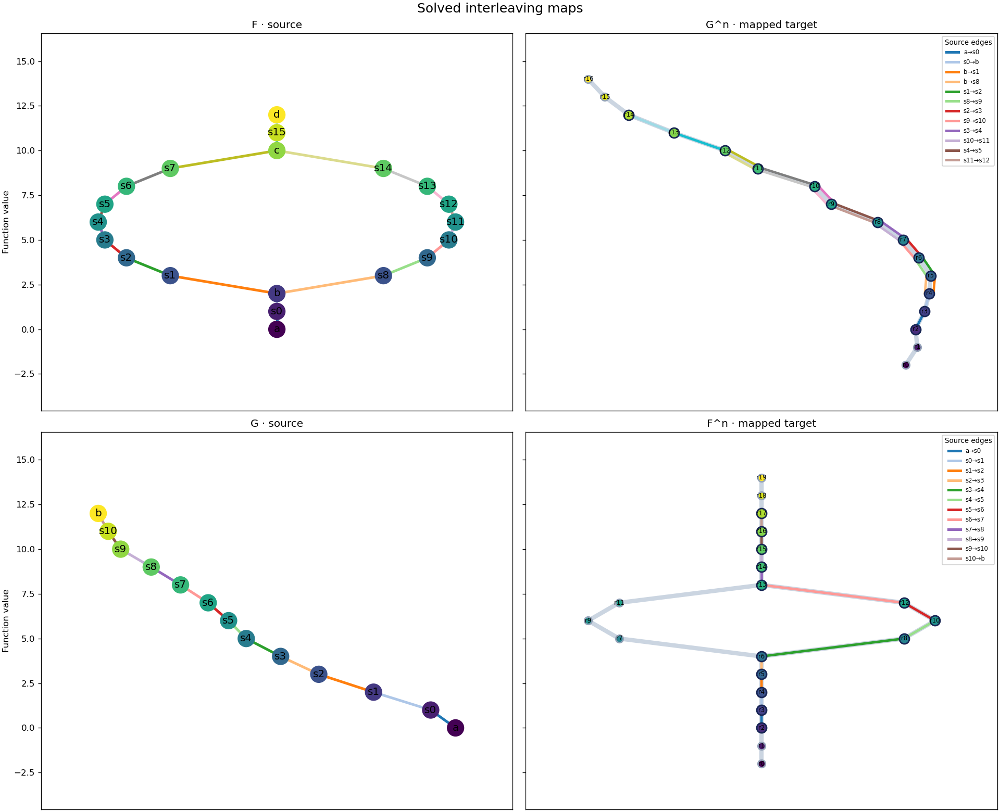

# Metro view of interleaving maps

The paired view places the source graph beside its smoothed target: `phi`
shows `F` with `G^n`, and `psi` shows `G` with `F^n`. Each source edge and
its mapped target strand use the same color. Target stations show the vertex
correspondences selected by the ILP. Node names use the same `s0` and `r0`
display format as `ReebGraph.draw()`.



```python
from cereeberus import Interleave
from cereeberus.data.ex_mappergraphs import line, torus
from cereeberus.draw.metro_maps import draw_map_pair, draw_interleaving_map_pairs

F = torus(0, 2, 10, 12, delta=1, seed=17)
G = line(0, 12, seed=5)
result = Interleave(F, G)
result.fit()

fig_phi, axes_phi = draw_map_pair(result, direction="phi")  # F | G^n
fig_psi, axes_psi = draw_map_pair(result, direction="psi")  # G | F^n
fig_both, axes_both = draw_interleaving_map_pairs(result)   # both rows
```

For `F^n -> G^2n` and `G^n -> F^2n`, pass `key="n"`. The earlier
`draw_metro_map` and `draw_interleaving_metro_maps` functions remain available
for destination-only views. A solved `Assignment` can also be passed directly.
None of these drawing functions reruns the solver or changes the graphs.

For `key="n"`, auxiliary map columns at newly added boundary levels may be
zero in a feasible ILP solution; these do not create strands. This is a direct
view of the ILP matrices rather than a full MetroSets layout optimizer. A
source edge is one strand; no path decomposition or uncertainty measure is
inferred. Parallel edges with identical endpoint labels inherit the current
matrix labeling and may share a drawn centerline.

For a worked, executed example, open the [metro interleaving notebook](../../notebooks/metro_interleaving_maps.ipynb).

Design references: [MetroSets](https://arxiv.org/abs/2008.09367),
[Topological Characterization and Uncertainty Visualization of Atmospheric Rivers](https://www.sci.utah.edu/~beiwang/publications/AR_BeiWang_2024.pdf), and
[Uncertainty Visualization for Approximated Barycenter of Contour Trees](https://www.sci.utah.edu/~beiwang/publications/Uncertainty_CT_BeiWang_2026.pdf).
