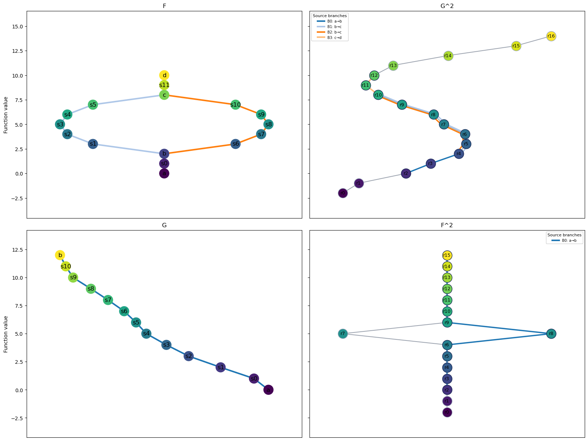

# Metro view of interleaving maps

`draw_metromaps` takes a fitted `Interleave` object and returns a Matplotlib figure. It reads the Mapper graphs, their smoothings, and the vertex and edge maps selected by the ILP. It does not run the optimization or alter the maps.

The default figure has two rows. The top shows the `phi` map, with $F$ beside $G^n$; the bottom shows the `psi` map, with $G$ beside $F^n$. A source edge and its mapped target strand have the same color. By default, successive edges between an endpoint or junction share one branch color. Set `color_by="edge"` to distinguish every edge. Target station labels show the mapped source vertices. Node labels follow `ReebGraph.draw()` (`s0`, `r0`, and so on).

Panel titles show `F` and `G` by default, or the input graphs’ `name` values if supplied. Smoothed panels show the fitted number, such as `G^2` and `F^2` when `n = 2`; auxiliary maps show `F^2` → `G^4` and `G^2` → `F^4`. Figures have no overall title.

The graphs use ceREEBerus’s saved `pos_f` coordinates, produced by its general function-height layout (`set_pos_from_f`); this view does not assign positions for the loop example. Smoothed graphs are laid out independently. Target edges are thin gray lines until a selected map uses them; mapped strands are colored and slightly thicker. When several source edges use one target edge, their colors appear in parallel lanes. Many shared routes can still crowd a panel.



```python
from cereeberus import Interleave
from cereeberus.data.ex_mappergraphs import line, torus
from cereeberus.draw.metromaps import color_by_branch, color_by_edge, draw_metromaps

F = torus(0, 2, 8, 10, delta=1, seed=17)
G = line(0, 12, seed=5)
result = Interleave(F, G)
result.fit()

figure = draw_metromaps(result)                     # both map directions
phi_figure = draw_metromaps(result, direction="phi") # F beside G^n
selected = next(iter(F.edges(keys=True)))
branch_figure = color_by_branch(result, selected, direction="phi")
edge_figure = color_by_edge(result, selected, direction="phi")
```

Use `direction="psi"` for just $G$ beside $F^n$. Set `key="n"` to view the auxiliary maps $F^n\to G^{2n}$ and $G^n\to F^{2n}$. The function returns the figure; its panels are available through `figure.axes`. The default `tab20` scheme has 20 colors and repeats them when a direction has more than 20 source branches or edges. A warning calls this out; set `warn_color_reuse=False` to silence it or choose another Matplotlib `color_scheme`. The legend displays at most 16 groups by default (`max_legend=16`), even when more are colored. Continuous colormaps such as `hsv` spread colors over the displayed groups.

`color_by_branch` accepts a branch number (`B0`, `B1`, ...) or any directed source edge within that branch. It highlights the whole source branch and every edge image selected by the ILP for that branch. These may split or overlap in the target; the highlight is the collection of edge assignments, not a new branch-level map. Use `direction="psi"` to select a branch of G. The separate `color_by_edge` function highlights one edge and its selected target strand. Include the edge key in `(u, v, key)` when parallel edges share endpoints. Neither focused view infers a path through the original, unsmoothed target graph.

Each source edge remains a separate ILP assignment. Branch coloring only groups adjacent edges visually; it does not infer a branch-level interleaving or an uncertainty value. Parallel edges with identical endpoint labels may share a drawn centerline. This is a direct plot of ceREEBerus outputs, inspired by the metro-map visual language of [MetroSets](https://arxiv.org/abs/2008.09367), not an implementation of its layout algorithms.

For a worked example, open the [metro interleaving notebook](../../notebooks/metro_interleaving_maps.ipynb).

Other visual references: [Topological Characterization and Uncertainty Visualization of Atmospheric Rivers](https://www.sci.utah.edu/~beiwang/publications/AR_BeiWang_2024.pdf) and [Uncertainty Visualization for Approximated Barycenter of Contour Trees](https://www.sci.utah.edu/~beiwang/publications/Uncertainty_CT_BeiWang_2026.pdf).
